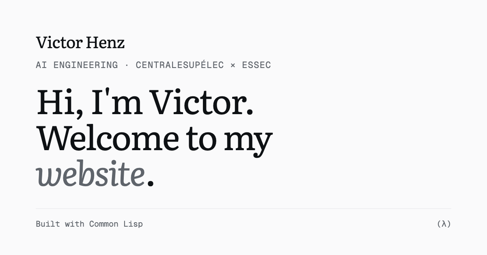

# Victor Henz — personal website

**Live:** https://victorhenz241-eng.github.io/victor_website/



My personal website: who I am, what I've built, and where I've worked. It is
generated by a few small Common Lisp programs. No framework, no npm, no build
tools: SBCL turns Lisp data into HTML, and plain CSS and JavaScript do the rest.

## What's interesting about it

- **Content is data.** Every word lives in [`src/content.lisp`](src/content.lisp) as Lisp
  lists. Add a project there and it gets a card, its own page, an entry in the
  ⌘K menu and a place in the side column, with no new HTML.
- **A hand-written HTML renderer.** [`src/html.lisp`](src/html.lisp) is about a
  hundred lines that turn `(:a :href "…" "GitHub")` into `<a href="…">GitHub</a>`.
- **"(λ) source".** A switch in the header turns each section into the real Lisp that
  produced it, comments included, with line numbers and syntax colors. The build
  reads its own source files with `READ` + `FILE-POSITION` to cut out each form exactly.
- **Measured build stats.** The footer says how long the pages took to render and
  how many bytes the page weighs. The size is inside the page it measures, so the
  build guesses, measures and repeats until the number describes itself.
- **Diagrams from data.** The architecture and graph diagrams on the project pages
  are written as Lisp lists and drawn as SVG at build time; they animate on scroll.
- **Quiet details.** A ⌘K command menu (native `<dialog>`, ARIA combobox), an
  auto / light / dark theme switch that never flashes the wrong theme, a side
  column with a table of contents on project pages, fingerprinted CSS/JS links so a
  browser never mixes new HTML with an old stylesheet, and videos that only download
  when you scroll to them.
- **Accessible by default.** Keyboard navigation, screen-reader labels, contrast
  checked in light and dark, and `prefers-reduced-motion` respected everywhere:
  nothing moves for people who asked their system for less motion.

## How it works

```
src/content.lisp ─┐
                  ├─► src/pages.lisp ─► src/html.lisp ─► public/*.html     structure (Lisp)
                  │                                          │
static/style.css ─┼──────────────────────────────────────────┤             look and motion (CSS)
static/*.js ──────┘──────────────────────────────────────────┘             behaviour (JS)
```

Lisp decides *what* is on the page and marks what should move; CSS decides how it
looks and moves; a little JavaScript decides *when*. The page is complete without
JavaScript: it just doesn't move.

Each push to `main` runs [`.github/workflows/deploy.yml`](.github/workflows/deploy.yml):
GitHub Actions installs SBCL, runs the build and publishes `public/` to GitHub Pages.

## Run it locally

You need [SBCL](https://www.sbcl.org/) (`brew install sbcl` on macOS,
`sudo apt install sbcl` on Linux) and Python 3 for the preview server.

```sh
sbcl --script make.lisp                    # builds the site into public/
python3 -m http.server -d public 8000      # then open http://localhost:8000
```

Or work from a REPL, rebuilding after each change:

```lisp
(require :asdf)
(asdf:load-asd (truename "victor-site.asd"))
(asdf:load-system "victor-site")
(in-package :victor-site)
(build)
```

## Project layout

```
src/
  content.lisp     all the text, as Lisp data
  html.lisp        Lisp lists -> HTML
  pages.lisp       layout, building blocks and pages (defpage macro)
  source.lisp      the "(λ) source" view: slices and colors the real source
  stats.lisp       the footer's build numbers
  media.lisp       photos and videos: shown only if the file exists, sizes read from the bytes
  build.lisp       writes everything into public/
static/            CSS, JS, media and the CV, copied as is into public/
scripts/           media preparation and the link-preview image (macOS tools)
docs/MEDIA.md      how every photo and video was made
LEARN.md           a guided tour of the code, concept by concept
```

## Learning

This is also a learning project: I built it while learning Common Lisp and front-end
design, working with [Claude Code](https://code.claude.com/docs). [`CLAUDE.md`](CLAUDE.md)
sets it up to explain before changing anything, and [`LEARN.md`](LEARN.md) starts
with a reading order, the concept behind each file, and small exercises.

## Media and privacy

Photos have all metadata removed (including GPS), and the Internship Radar demo has
every company and person name blurred. [`docs/MEDIA.md`](docs/MEDIA.md) explains how
each file was made and how to redo it.

## Custom domain

The site lives at `victorhenz241-eng.github.io/victor_website/` for now. To move it
to a domain: set `*domain*` in `src/content.lisp` (the build then writes `CNAME`,
the canonical links and root-relative 404 links), add the domain under
**Settings → Pages → Custom domain**, add the DNS records GitHub shows, then tick
**Enforce HTTPS**. A site deployed by GitHub Actions ignores the `CNAME` file on its
own, so the Settings step is required.

---

© Victor Henz. The text, photos, videos and CV are mine; please don't reuse them.
